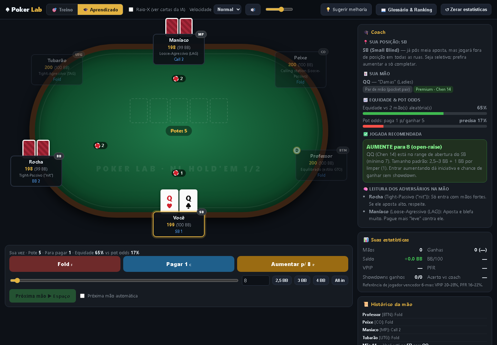

# ♠ Poker Lab — Texas Hold'em trainer with an AI coach

[](https://github.com/AndreSouzaTI/poker-lab/actions/workflows/ci.yml)


[](LICENSE)

**▶ Play it now: https://andresouzati.github.io/poker-lab/**

A No-Limit Texas Hold'em table (6-max) where you play against 5 AI opponents and, if you want, get a coach that explains every decision. I built it for two reasons: **to learn poker properly** and **to practice the technologies behind it** (game state machines, Monte Carlo simulation, the Web Audio API, and plain JavaScript with no framework).

> The interface is in Brazilian Portuguese and uses the poker slang Brazilian players actually use (trinca, set, c-bet, nuts…). A Portuguese summary is at the end of this file.



---

## Features

### 🎯 Training mode
Just you against the machine: blinds 1/2, 200-chip stacks, the dealer button moves each hand, side pots and all-ins work, and busted players rebuy automatically.

### 🎓 Learning mode
On every decision, a coach panel shows:

| Panel | What it tells you |
|---|---|
| **Position** | What UTG, MP, CO, BTN, SB and BB mean, and roughly how many hands to play from each |
| **Your hand** | Pre-flop: Chen score, hand type (suited, connectors, broadway) and nicknames (Pocket Rockets, Cowboys, Big Slick…). Post-flop: top pair, overpair, set vs trips, flush draw, open-ended, gutshot |
| **Board texture** | Dry, wet, paired, monotone, connected |
| **Equity & pot odds** | Your chance of winning (Monte Carlo, 2,000 runs) against the pot odds you are being offered |
| **Outs** | Which cards improve you, grouped by hand, with the rule of 4 and 2 |
| **Recommended play** | Fold / check / call / bet / raise, the size, and *why* |
| **Hands that beat you** | Every possible opponent combination checked against yours, grouped ("any Kx", "two hearts"…) |
| **Opponent read** | Each bot's style (nit, TAG, LAG, calling station, balanced) and how to play against it |

After each hand you get a review with ✅/❌ next to every decision you made.

### 📊 Stats
Hands, win rate, BB/100, VPIP, PFR, showdowns won, how often you agreed with the coach, your most common mistakes, the starting hands that cost you the most, and your recent lost showdowns. Saved in the browser (`localStorage`).

### Also
- 🔊 Sound effects synthesized in real time with the Web Audio API (no audio files)
- 🩻 X-ray mode to see the bots' cards while learning
- 📖 Glossary and hand-ranking table
- ⌨️ Shortcuts: `F` fold · `C` check/call · `R` raise · `Space` next hand

---

## How it works

| Piece | Where | Approach |
|---|---|---|
| Hand evaluator | [`js/engine.js`](js/engine.js) | Ranks 5–7 cards into a single comparable number (category × 15⁵ + kickers) |
| Equity | [`js/engine.js`](js/engine.js) | Monte Carlo: deals the unknown cards thousands of times with a partial Fisher–Yates shuffle |
| Pre-flop strength | [`js/engine.js`](js/engine.js) | Chen formula + opening thresholds per position |
| "Hands that beat you" | [`js/engine.js`](js/engine.js) | Exhaustive check of all ~1,081 opponent combinations |
| Betting engine | [`js/game.js`](js/game.js) | State machine for streets, minimum raises, all-ins and side pots built from contribution levels |
| Bots | [`js/game.js`](js/game.js) | Five profiles with different looseness, aggression and bluff frequency; post-flop decisions use equity vs pot odds |
| Sound | [`js/audio.js`](js/audio.js) | Oscillators and filtered noise from the Web Audio API |

No build step, no framework, no dependencies: plain HTML, CSS and JavaScript.

**Known limitation:** equity is calculated against random hands. When someone bets, the coach discounts it to account for a stronger range, but it is an estimate, not a solver.

---

## Run locally

```bash
git clone https://github.com/AndreSouzaTI/poker-lab.git
cd poker-lab
```

Open `index.html` in your browser. That's it.

### Tests

The engine (evaluator, equity, Chen, outs) is covered by tests using Node's built-in test runner (Node 18+):

```bash
npm test
```

They also run on GitHub Actions on every push.

---

## 💡 Suggestions welcome

This project is open to ideas. If you play poker (or just tried it) and something could be better — a smarter bot, a new stat, a coach explanation that's wrong — please:

- open a **[suggestion](https://github.com/AndreSouzaTI/poker-lab/issues/new/choose)** or a bug report, or
- send a pull request (see [CONTRIBUTING.md](CONTRIBUTING.md)).

There is also a **💡 Sugerir melhoria** button inside the game.

Ideas already on my list: tournament mode with rising blinds, hand-history replay, range charts per position, and an English translation.

---

## 🇧🇷 Em português

**Poker Lab** é uma mesa de Texas Hold'em No-Limit (6 jogadores) para treinar contra 5 IAs. Fiz para **aprender poker de verdade** e **treinar as tecnologias usadas** (JavaScript puro, simulação Monte Carlo, Web Audio API e máquina de estados).

- **Modo Treino:** só jogar contra a máquina.
- **Modo Aprendizado:** coach com posição, força da mão, textura da mesa, equidade, pot odds, outs, jogada recomendada e as mãos que te batem, usando os termos que a galera usa (trinca, set, c-bet, nuts…).
- **Estatísticas:** VPIP, PFR, BB/100, erros mais comuns e as mãos que mais te custaram.

**Jogue:** https://andresouzati.github.io/poker-lab/ · **Sugestões são muito bem-vindas:** abra uma [issue](https://github.com/AndreSouzaTI/poker-lab/issues/new/choose).

---

## License

[MIT](LICENSE) © André Souza

*Built for learning. No real money involved.*
